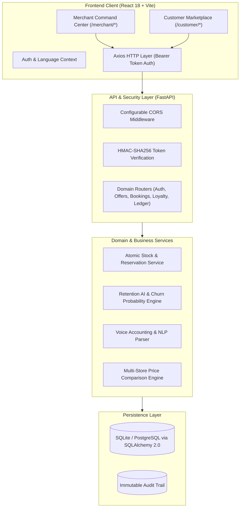
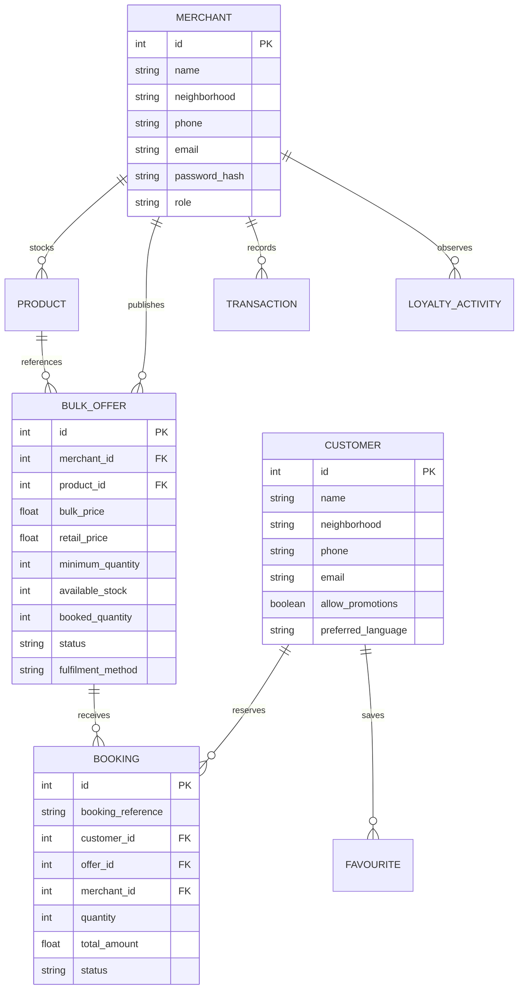
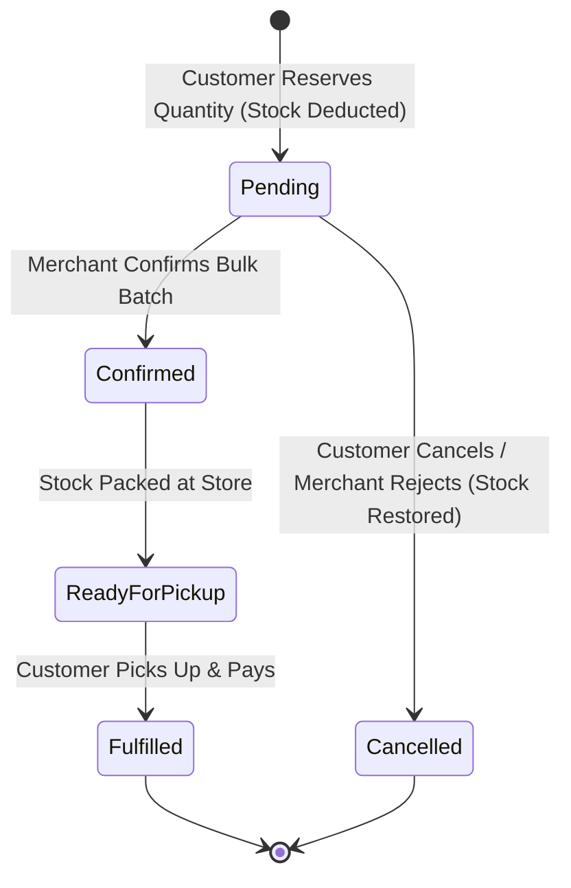

# Paytm Vyapar-Brain — Technical Architecture

This document provides a comprehensive technical overview of the **Paytm Vyapar-Brain** neighborhood commerce and merchant growth platform, detailing system architecture, data models, trust boundaries, state machines, and security controls.

---

## 1. System Architecture Overview

Paytm Vyapar-Brain is structured as a decoupled two-sided application with a React/TypeScript client interface and a high-throughput Python FastAPI backend.

---

## 2. Core Entities and Data Schema

---

## 3. Order & Stock Reservation State Machine

To prevent inventory overselling during high-demand bulk runs, stock reservation uses atomic database locking (`with_for_update()` / row-level transactions):

---

## 4. Retention AI & Churn Probability Engine

The loyalty engine calculates customer visit cadence deterministically:
$$\text{Lapse Ratio} = \frac{\text{Current Date} - \text{Last Visit Date}}{\text{Average Historic Visit Interval}}$$

* **Active Regular:** $\text{Lapse Ratio} < 1.5$
* **Potentially Inactive / At-Risk:** $\text{Lapse Ratio} \ge 1.5$

Before drafting outreach campaigns, the system verifies the consumer's **DPDP Act 2023** marketing consent flag (`allow_promotions == True`).

---

## 5. Security & Trust Boundaries

| Boundary | Enforcement Mechanism | Failure Behavior |
| :--- | :--- | :--- |
| **API Authentication** | HMAC-SHA256 signature verification over session claims with expiration timestamps | `401 Unauthorized` |
| **Store Data Isolation**| SQL query filters scoped strictly to `merchant_id` | Zero cross-merchant leakage |
| **Invoice File Uploads** | Extension whitelist (`.jpg`, `.jpeg`, `.png`, `.pdf`, `.webp`), path traversal sanitization, and 5MB size limit | `400 Bad Request` |
| **CORS Access** | Configurable via `CORS_ORIGINS` environment variable | Restricted origin blocking |
| **Audit Trail** | Automatic insertion into `audit_logs` for authentication, status transitions, and settings changes | Immutable historical log |
